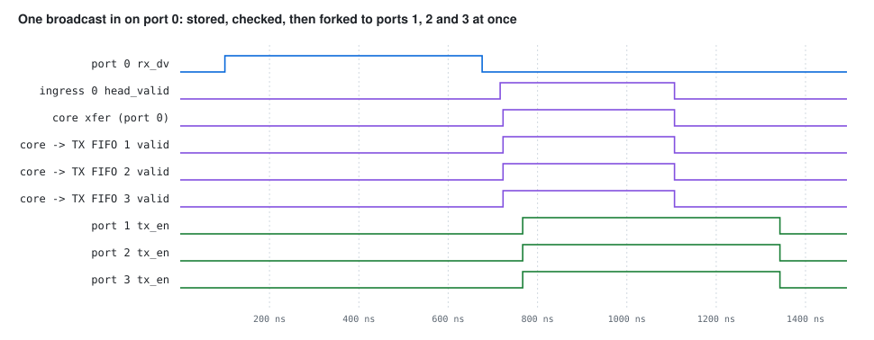
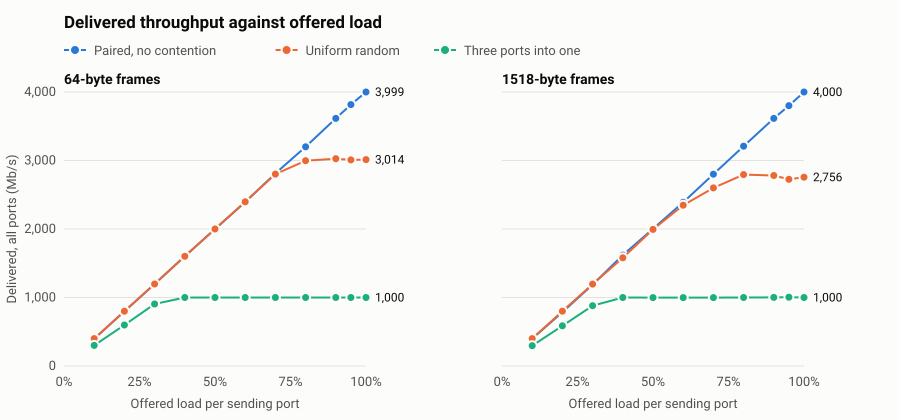

# 1G Ethernet MAC + 4-Port Layer-2 Learning Switch

[](https://github.com/Prajesh-47/Ethernet_MAC_L2_Switch/actions/workflows/ci.yml)


A gigabit Ethernet MAC (GMII, 8 bits at 125 MHz) and a 4-port store-and-forward
learning switch built from it, in Verilog, with **AXI4-Stream** between every block.

- **MAC**: preamble/SFD, padding to 64 bytes, CRC-32 FCS generate and check, runt / oversize / `rx_er` detection, TX underrun signalling
- **Clock crossing**: every port's RX and TX path crosses into a 156.25 MHz system clock through the [Asynchronous_FIFO](https://github.com/Prajesh-47/Asynchronous_FIFO) project (Gray pointers, 2-flop synchronizers)
- **Switch**: 4 KB store-and-forward buffer per port, 16-entry MAC learning table, broadcast/unknown flooding, same-port filtering, a deadlock-free arbiter and a lock-step AXI-Stream fork for floods

It is verified bottom-up: a self-checking testbench for every block, then the whole switch
under random traffic with a reference model, coverage, liveness and protocol checks.
Eight deliberate bugs are built in behind `ifdef`s, and the suite shows which test catches each one.

<p align="center"></p>

## Results

| Check | Result |
| --- | --- |
| Unit tests | 8 testbenches (CRC, TX, RX, MAC loopback, ingress buffer, MAC table, switch core, 4-port smoke), all pass |
| MAC loopback across clocks | 221 frames × 5 clock setups; with the system clock deliberately too slow, 188 frames **flagged bad, 0 silently corrupt** |
| Switch, no-drop mode (20% load) | every expected copy delivered, e.g. **1,321 / 1,321**, 0 errors, 3 seeds, at both 156.25 MHz and the 125 MHz minimum |
| Throughput and latency | about **170 ns** latency without contention; **full line rate** on all ports without contention from 512 bytes up (98.9% at 64); random traffic saturates at **70–75%** ([details](docs/performance.md)) |
| Functional coverage | **24 / 24 bins** (every unicast pair, flood, filter, bad-frame kinds, min/max size, contention, parallel starts); a hole fails the test |
| Switch, congestion mode (100% load) | 38–46% of copies dropped (see [Limitations](#limitations)), **nothing corrupted or reordered**, longest wait 8,989 cycles (limit 20,000) |
| Protocol | 0 AXI-Stream violations on the core's outputs (unit test and whole switch) |
| Injected bugs | **8 / 8 caught** by unit tests; 6 / 8 also by the whole-switch test ([why not all 8](#two-bugs-the-whole-switch-test-cannot-see)) |
| Lint | clean, Verilator `-Wall` (unused-signal warnings waived, see Makefile) |
| FPGA estimate (ECP5-45, speed 8, three seeds) | routes at 19% logic, 8 block RAMs, but **does not meet timing yet**: `sys_clk` 98–102 MHz against a 125 MHz minimum (see [the timing log](docs/fpga_timing.md)) |

## Waveform

Smoke-test step 1: station A broadcasts one 64-byte frame into port 0. The ingress
buffer offers it only after the last byte and the CRC verdict are in (store-and-forward),
the core wins all three other ports in the same cycle, and three identical copies leave together.

<p align="center"></p>

## Performance

Measured in simulation at a 156.25 MHz system clock, over 594 runs across 3 traffic patterns, 6 frame sizes and 11 loads.
Random traffic levels off at 70–75% of line rate because of head-of-line blocking (see [Limitations](#limitations)),
while the same hardware reaches full rate when ports don't compete. Every delivered frame was checked byte for byte.
See [the full results](docs/performance.md).

<p align="center"></p>

## Quick start

```bash
# Ubuntu 24.04 (also works in WSL2): Verilator 5.020
sudo apt install verilator make build-essential

make test       # lint + every unit test + randomized switch at 156.25 and 125 MHz + performance limits + unit-level bug injection
make all        # test + congestion mode + whole-switch bug injection  (~10 min)
make wave       # smoke test with a VCD: build/switch.vcd (gtkwave), redraws docs/waveform.svg
```

| Target | What it does |
| --- | --- |
| `make lint` | Verilator `-Wall` on the whole switch |
| `make crc` `tx` `rx` | CRC-32, transmit MAC and receive MAC unit tests |
| `make loop` | one full MAC (TX + RX + both async FIFOs) in loopback at 5 clock setups |
| `make ingress` `table` `core` | ingress buffer, MAC table and switch core unit tests |
| `make smoke` | the 4-port switch, 10 directed steps over GMII |
| `make sim` | the 4-port switch under random traffic, no-drop mode, 3 seeds |
| `make congest` | the same at 100% load, drops allowed, 3 seeds |
| `make perf` | throughput and latency sweep, writes `docs/perf/`, about 4 minutes |
| `make perfcheck` | fixed performance points against limits, fails if the switch gets slower |
| `make sim125` | the whole switch at the 125 MHz minimum system clock: smoke test, then both loads, 3 seeds |
| `make bugs` | rebuild with each injected bug; fails unless its unit test catches it |
| `make sysbugs` | every injected bug through the whole-switch test (expected results checked) |
| `make synth` | Yosys synthesis for Xilinx 7-series and ECP5, prints cell counts (needs `yosys`) |
| `make pnr` | ECP5 place-and-route over three seeds, prints utilization and Fmax; reports timing without failing (needs `nextpnr-ecp5`) |

Every target fails unless its test prints `RESULT: PASS`, so CI cannot go green on a failing test.

## How it works

**CRC-32** (`rtl/crc32.vh`). The IEEE 802.3 polynomial in its reflected form `0xEDB88320`,
one byte per clock, starting from `0xFFFFFFFF`. The transmitter sends the inverted CRC, LSB first.
The receiver runs the same CRC over the data **and** the FCS: a good frame always leaves the
fixed residue `0xDEBB20E3`, so it never has to find where the FCS starts.

**Receive MAC** (`rtl/eth_mac_rx.v`). Strips the preamble and SFD, then delays bytes through a
5-byte shift register: when `rx_dv` falls, the register holds the last data byte plus the four
FCS bytes, so the FCS never reaches the output. The verdict rides on `tuser` with `tlast`:
bad if the residue is wrong, the frame is under 64 or over 1518 bytes, the PHY raised `rx_er`,
or bytes were lost because GMII cannot be back-pressured.

**Transmit MAC** (`rtl/eth_mac_tx.v`). A state machine: preamble, SFD, data (`tready` only here),
zero padding up to 60 bytes, FCS, inter-frame gap. If the AXI-Stream source runs dry mid-frame
it raises `tx_er`, so the far end discards the frame instead of accepting a truncated one.

**Clock crossing** (`rtl/eth_mac.v`, `rtl/cdc/`). Each MAC runs on its GMII clock and the switch
on the system clock. One async FIFO per direction carries the stream across, each domain has its
own reset synchronizer, and the TX FIFO's fill level (`s_fill`, the writer's view) tells the
switch when a port has finished sending.

**Ingress buffer** (`rtl/ingress_buf.v`). Bytes are written into a 4 KB memory as they arrive.
At `tlast` the frame is **committed** only if the MAC said good, it is at least a 14-byte header,
every byte fitted, and the 8-entry descriptor queue has room. Otherwise the write pointer
**rewinds** to the frame's start and the frame never existed. A commit queues a descriptor
`{length, destination}` and asks the table to learn `source → this port` (never for a
multicast source). This is what lets a switch drop CRC-bad frames: the verdict only exists
once the whole frame is in. The memory has a registered read so it maps to block RAM, and a
4-entry prefetch FIFO keeps output back-pressure away from the RAM address. A frame's first byte
appears 3 clocks after the core starts it, then the frame streams with no gaps.

**MAC table** (`rtl/mac_table.v`). 16 entries, fully associative, with one comparator bank shared by
learning and all four ports through a 3-stage pipeline. While a frame is at the head of its queue, its
destination is looked up repeatedly, so the result follows the table; `lk_valid` says the result
belongs to that frame. Lookups answer within 8 cycles in the tests. A round-robin arbiter takes one
learn request at a time (3 cycles each): a known address gets its port updated (the station moved);
a new one replaces the oldest entry.

**Switch core** (`rtl/switch_core.v`).

| Destination | Goes to |
| --- | --- |
| broadcast / multicast | every port except its own (flood) |
| not in the table | flood |
| in the table, another port | that port |
| in the table, the same port | nowhere (filtered: the station already heard it) |

*Arbitration.* An output is free when nobody owns it and its TX FIFO is empty. An input waits for its
table result (`lk_valid`), its destination set is stored for one cycle, and it then starts only when it holds **every** port it needs, so a flood's copies
start together. All four output
arbiters share **one** round-robin pointer: the top-priority input wins every free port it wants,
so it always eventually gets its full set. With a pointer per output, input A could hold port 2
while B holds port 3, each waiting for the other forever (`BUG_PER_EGRESS_PRIORITY` shows it).

*The fork.* A flood streams one input to up to three outputs. The input advances only when every
destination has taken the current byte; a `done[e]` bit per output drops that output's `tvalid`
right after its own handshake. `tvalid` never depends on `tready`, and once high it stays high
until `tready` — both AXI-Stream rules.

*No underrun.* Because an output is granted only when its TX FIFO is empty, every copy starts
from empty and drains at the same 125 MHz, so a lock-stepped fork can never starve one copy
mid-frame. The tests treat any underrun as an error.

## Verification

Each layer checks what the one above cannot reach easily; each testbench has a driver,
monitor, scoreboard and an independent reference (written from the spec, not the RTL).

| Testbench | What it proves | Numbers |
| --- | --- | --- |
| `tb_crc32` | check value `CRC("123456789") = 0xCBF43926`, residue, single-bit errors detected | 2,000 random messages vs a bit-serial reference |
| `tb_mac_tx` | preamble, padding, FCS, gap ≥ 12, `tx_er` on a deliberate underrun | 312 frames, half back-to-back |
| `tb_mac_rx` | verdict for good, bad CRC, runt, oversize, `rx_er`, lost data, noise; FCS stripped | 381 frames, preambles 1–7 bytes |
| `tb_mac_loop` | both CDC crossings at 5 clock setups; the TX empty flag is never wrong; when starved, damage is **flagged, never silent** | 221 frames per setup |
| `tb_ingress_buf` | a predictive model of every keep/drop decision, incl. buffer filled to the exact last byte; output stable under back-pressure, no gaps inside a frame | 2,019 frames, every drop reason hit |
| `tb_mac_table` | results vs a model, results follow the table, no stale result after an address change, oldest-first eviction, station moves, arbiter never starves anyone | 100,349 results checked, 1,011 evictions, longest waits 8 cycles (lookup) and 11 (learn) |
| `tb_switch_core` | forwarding rules, waits for the table result, table changing while a frame waits, AXI-Stream on every output, start only into an empty FIFO, liveness | 6,390 / 6,390 copies, 0 AXI violations |
| `tb_switch_smoke` | 10 directed steps over GMII: learn, unicast, flood, filter, bad frame not learned, station move, contention | all 10 steps exact |
| `tb_perf` | whole-switch throughput and latency across patterns, sizes and loads; every frame still checked byte for byte | 594 runs |
| `tb_switch` | whole switch: 4 independent RX clocks, legal gaps checked on the wires, reference model, ordered scoreboard per port pair, 24 coverage bins, liveness, internal AXI check | ~1,300 copies per seed, both modes |

### Injected bugs

| Define | Bug | Caught by unit test | Caught by whole switch |
| --- | --- | --- | --- |
| `BUG_RX_NO_CRC` | RX MAC ignores CRC errors | `tb_mac_rx` | yes |
| `BUG_NO_REWIND` | a dropped frame's bytes stay in the buffer | `tb_ingress_buf` | yes |
| `BUG_NO_LEARN` | the table never learns | `tb_mac_table` | yes |
| `BUG_NO_MOVE` | a station that moves keeps its old port | `tb_mac_table`, smoke step 9 | **no** |
| `BUG_PER_EGRESS_PRIORITY` | no shared arbiter pointer | `tb_switch_core` (deadlock) | yes (starvation) |
| `BUG_FORK_ANY_READY` | fork advances when *one* destination took the byte | `tb_switch_core` | yes |
| `BUG_FORK_GATED_VALID` | `tvalid` gated by the other ports' `tready` | `tb_switch_core` (AXI) | **no** |
| `BUG_NO_FILTER` | a frame for its own port is sent back out of it | `tb_switch_core` | yes |

### Two bugs the whole-switch test cannot see

- **`BUG_NO_MOVE`**: stations never change port in the random traffic, so the random test has no
  way to notice. The table's unit test and smoke step 9 do.
- **`BUG_FORK_GATED_VALID`** is *latent* in this system. Every copy of a frame starts from an empty
  FIFO and drains on the same clock, so all destinations' `tready` fall on the same edge and the
  bad gating never fires — not even with skewed TX clock phases (tried). It only shows when
  destinations back-pressure independently, which `tb_switch_core` forces. This bug was in the
  first version of the core; the unit test found 146,408 AXI-Stream violations and it was fixed.
  A protocol bug can sleep in one integration and break the next, which is why the protocol is
  checked at the block boundary.

`make sysbugs` checks this exact pattern, so the table above cannot silently go out of date.

## Repository layout

```
rtl/          crc32.vh, eth_mac_rx/tx, axis_skid, eth_mac (MAC + CDC), ingress_buf, mac_table,
              switch_core, eth_switch_4port (top)
rtl/cdc/      async FIFO, synchronizers, reset sync (from the Asynchronous_FIFO repo)
tb/           one self-checking testbench per block, plus smoke and randomized switch tests
syn/          clock targets for the FPGA flow
docs/         block diagram, waveform and its generator, project guide, performance results and charts,
              timing log, roadmap, ASIC assessment
.github/      CI: lint + all tests + FPGA synthesis + congestion + bug injection on every push
```

About 1,500 lines of RTL and 2,150 lines of testbench.

## Further documentation

- [Project guide](docs/project_guide.md): the whole project explained from the start, with no Verilog needed
- [Performance](docs/performance.md): throughput and latency results, how they're measured, and their limits
- [FPGA timing log](docs/fpga_timing.md): current area and Fmax, how to reproduce them, what each change did and why, and the next timing fixes
- [Roadmap](docs/roadmap.md): planned phases without physical hardware, from timing and performance to real traffic in simulation, formal proofs and features
- [ASIC assessment](docs/asic_assessment.md): whether open-source ASIC tools could take this design to a chip layout

## Limitations

- **Head-of-line blocking.** One input queue per port: a frame waiting for a busy output blocks
  everything behind it, even frames for idle outputs. That is a large part of the 38–46% drop
  rate at 100% load. Virtual output queues would fix it.
- **Small, simple table.** 16 entries, no aging timer (a real switch ages entries out after ~300 s),
  oldest-first replacement.
- **No VLANs, no pause frames, no jumbo frames.** Frames over 1518 bytes are dropped.
- **Transmit gap is 13 byte times**, one more than the 12-byte minimum: compliant, 1 byte slower than necessary.
- **One TX clock** for all ports, as on most boards where the MAC drives GTX_CLK.
- **Does not meet timing yet, and has never run on hardware** (no board is planned). After place-and-route on an ECP5-45
  (speed grade 8, three seeds, I/O pins unconstrained), `sys_clk` reaches 98–102 MHz against a 125 MHz
  minimum, and the GMII clocks reach 111–167 MHz against 125 MHz. See the [timing log](docs/fpga_timing.md).
- Simulation verifies the logic around the synchronizers, not metastability itself.

## License
MIT — see [LICENSE](LICENSE).
