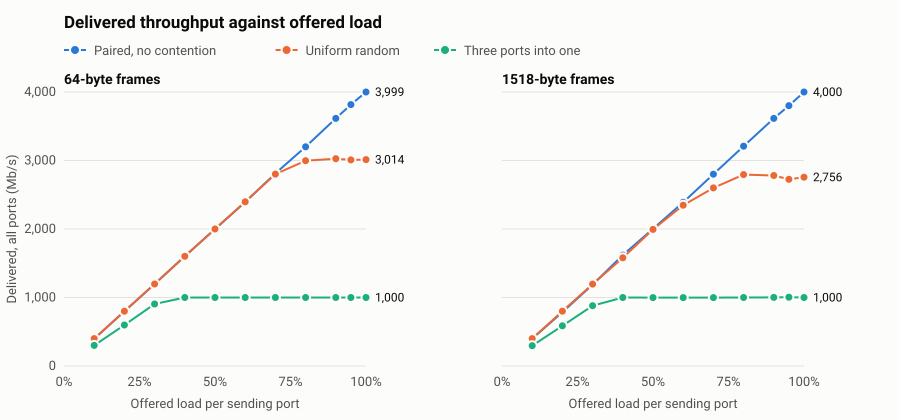
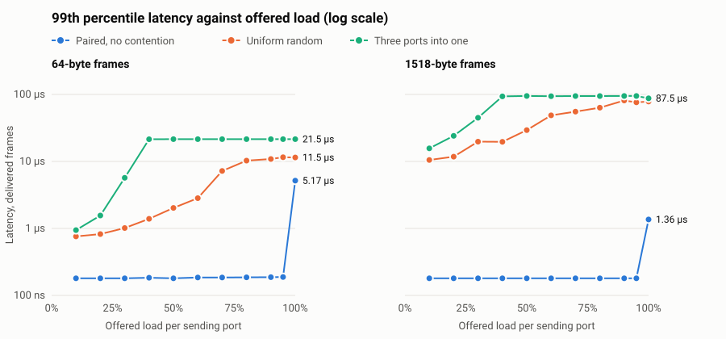

# Performance

How fast the switch is, measured in cycle-accurate simulation at a 156.25 MHz system clock. These numbers
describe the RTL's behaviour. They assume that clock is reached, and the
[FPGA estimate](fpga_timing.md) doesn't reach it yet. Nothing here has run on hardware.

## Summary

| Question | Answer |
| --- | --- |
| Latency with no contention | **About 170 ns** (median), last bit in to first bit out, at any frame size and load |
| Ports not competing for an output | **Full line rate** on all 4 ports at every frame size, with no drops |
| Random traffic, all ports | **Saturates at about 70-75%** of line rate (2,756-3,014 of 4,000 Mb/s) |
| Three ports into one | The output runs at full rate (1,000 Mb/s), and the rest is dropped |
| Frame integrity | Every delivered frame correct, in all 594 runs, including overload |

<p align="center"></p>

<p align="center"></p>

## What the results show

**Head-of-line blocking sets the limit for random traffic.** Throughput stops rising at 70-75%, even though every
port has spare capacity. Each input has one queue, so a frame waiting for a busy output blocks frames behind it
that want idle outputs. Paired traffic has no such conflicts and reaches full rate on the same hardware. The
classic result for a 4-port input-queued switch at saturation is about 65.5% (Karol, Hluchyj and Morgan, 1987). That
model uses fixed-size cells and synchronized slots, so it's a reference point, not a direct comparison. Virtual
output queues should remove this limit, and these curves are the baseline to test that against.

**A one-byte transmit gap fix gave full rate at 100% load.** The transmitter used to leave 13 idle bytes between
frames, one more than the minimum, so it sent each frame slightly slower than it arrived. With paired traffic at 100%
load, queues slowly filled at every frame size. At 64 bytes, 3,955 Mb/s got through, with 0.4% dropped and a 3.7 µs
median latency. At 1518 bytes, the median latency was 835 ns. With the gap at exactly 12, paired traffic at 100% load
delivers 3,999-4,000 Mb/s with no drops, and the median latency stays at 180-187 ns. Random traffic didn't change
beyond seed variation, because head-of-line blocking limits it first.

**Latency stops rising when buffers are full.** Under overload, latency levels off because the queue can't get any
longer. Beyond that point frames are dropped instead. At 64 bytes the 8-entry descriptor queue is the limit. At larger
sizes the 4 KB buffer is. Latency only describes frames that were delivered.

**Large frames start dropping earlier.** The highest load with no drops on any seed:

| Frame size | Paired | Uniform random | Three into one |
| --- | --- | --- | --- |
| 64 | 100% | 60% | 30% |
| 128 | 100% | 60% | 30% |
| 256 | 100% | 60% | 30% |
| 512 | 100% | 60% | 30% |
| 1024 | 100% | 50% | 30% |
| 1518 | 100% | 40% | 20% |

Three inputs into one output can't exceed 33% each, so 30% is the top tested load below that limit. A 4 KB buffer
holds fewer than 3 full-size frames, so large frames have less room for bursts.

## At 100% offered load

| Pattern | Frame size | Delivered (Mb/s) | Dropped | Median latency | 99th percentile |
| --- | --- | --- | --- | --- | --- |
| Paired | 64 | 3,999 | 0% | 180 ns | 185 ns |
| Paired | 256 | 4,000 | 0% | 180 ns | 185 ns |
| Paired | 1518 | 4,000 | 0% | 187 ns | 188 ns |
| Uniform | 64 | 3,014 | 24.0% | 6.1 µs | 10.9 µs |
| Uniform | 256 | 2,875 | 26.9% | 20.8 µs | 35.9 µs |
| Uniform | 1518 | 2,756 | 29.9% | 21.7 µs | 80.3 µs |
| Three into one | 64 | 1,000 | 65.7% | 10.2 µs | 21.0 µs |
| Three into one | 256 | 1,000 | 65.1% | 46.5 µs | 68.6 µs |
| Three into one | 1518 | 1,000 | 65.6% | 74.0 µs | 86.3 µs |

Every point, for all sizes and loads, is in [perf/results.csv](perf/results.csv).

## How it's measured

`tb/tb_perf.sv` drives the whole switch over GMII after each station has broadcast once, so all addresses are known.

| Item | Definition |
| --- | --- |
| **Line rate** | 1,000 Mb/s per port, counting preamble, frame and minimum gap (size + 20 bytes) |
| **Offered load** | Per sending port. Gaps vary randomly around the mean, so ports don't fall into lock-step |
| **Rates** | Over a window with all senders active, skipping the first 10% of frames |
| **Latency** | Store-and-forward definition (RFC 2544): end of the frame on rx to the start of its preamble on tx |
| **Grid** | 3 patterns, 6 frame sizes, 11 loads, 3 seeds: 594 runs. Plotted points are the mean of the seeds |

Patterns:

- **Paired:** 0↔1 and 2↔3, so no two ports want the same output.
- **Uniform:** each port sends to a random other port.
- **Three into one:** ports 1, 2 and 3 send to port 0.

Every delivered frame is checked byte for byte, including its FCS, output port and order. The test also fails on any
TX underrun or `tx_er`, any flooding after learning, a generator gap under 12 bytes, or an offered load more than
12% from what was requested.

**Latency excludes the time to receive the frame.** With store-and-forward, the frame must arrive in full before it
can leave, so add its time on the wire for a first-bit-to-first-bit figure: 512 ns for 64 bytes, and 12.1 µs for 1518.

## Limits of these results

- **Few frames at large sizes:** 150 frames per port at 1518 bytes, so these points are noisier. The small dip then rise
  in the uniform 1518-byte throughput curve is likely noise.
- **Simple traffic:** one station per port, one frame size per run, and steady random gaps. Real traffic is burstier, and
  mixes sizes, which may do worse.
- **Simulated clocks:** the four RX clocks have the same frequency and differ only in phase.

## Reproducing and regression checks

```bash
make perf        # the full sweep, about 4 minutes on 16 cores: docs/perf/results.csv and the charts
make perfcheck   # 8 fixed points against limits, part of make test and CI
```

`make perfcheck` fails if the switch gets slower. Its limits are set below the measurements in
`docs/perf_check.py`, so seed variation doesn't trip them. A copy of the switch with 1 KB buffers failed it, as it should.

## A bug this work found in the existing test

The first results showed 4,377 Mb/s offered on four 1,000 Mb/s ports, which is impossible. In both `tb_perf` and
`tb_switch`, a `repeat` loop that waits out the gap between frames ran about a quarter of its count with all four ports
active. Before the fix, `tb_switch` produced gaps as small as 7 bytes at "100%" load, when Ethernet requires 12, and at
"20%" load its gaps were about a quarter of what they should have been.

The exact trigger isn't known: small test cases with the same `repeat` forms counted correctly on Verilator 5.020.
Replacing `repeat` with `for` loops fixed it. Both tests now also measure the gaps on the wires themselves, and fail if
any is under 12 bytes.

Congestion-mode figures published before this fix came from illegally overdriven traffic. The switch's behaviour was not at
fault: frames were never corrupted. With correct traffic, `make congest` dropped 38-46% of copies, against the 36-44% measured
just before the fix. Since the transmit gap was cut to 12 bytes, it drops 35-42%.
